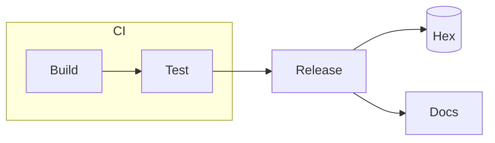

# Draw a diagram from Mermaid

This guide shows how to draw a diagram from a source in the language of Mermaid, and how to
show its parts step by step. For each option, see
[The diagram element](../reference/diagram-element.md).

## Install Node

Expresso holds a copy of [Pele](https://pele.run), a library in JavaScript that draws each
diagram type of Mermaid. The render runs Pele with Node, so the computer that renders the
deck needs Node. The document holds the SVG, so a browser that presents the deck does not
need Node.

| Tool | Program | Install |
| --- | --- | --- |
| Node | `node` | `brew install node`, `apt-get install nodejs`, or https://nodejs.org |

The render finds the program on the `PATH`. To use a program at a different place, give its
path in `EXPRESSO_NODE`. A deck without a Mermaid diagram needs no Node.

## Show a flowchart node by node

Write the diagram in a `.mmd` file next to the deck:



Write a `diagram` element with the path of the file. A `part` names a node by its id in the
source, and its `at` option gives its steps. An edge without a part shows from the step where
both of its nodes show, so the edges come with their nodes:

```elixir
defmodule Examples.MermaidFlowchart do
  use Expresso

  root __DIR__

  slide "the release" do
    heading "The release"

    diagram "release.mmd" do
      width "80%"

      part "test", at: [from: 2]
      part "release", at: [from: 3]
      part "hex", at: [from: 4]
      part "docs", at: [from: 4]
    end
  end
end

Examples.MermaidFlowchart
```


The diagram takes the colors and the font of the theme. A part of an edge has the name of its
two ends, such as `part "test->release"`, and a part of a subgraph has its id, such as
`part "ci"`.

## Show a sequence diagram message by message

Write the source in the deck with the `source` option and `lang :mermaid`. A part names a
message by its two actors and its arrow, such as `Web->DB`:

```elixir
defmodule Examples.MermaidSequence do
  use Expresso

  slide "a request" do
    heading "A request"

    diagram do
      lang :mermaid
      width "70%"

      source """
      sequenceDiagram
        participant Browser
        participant Web
        participant DB
        Browser->>Web: GET /deck
        Web->>DB: read the slides
        DB-->>Web: the slides
        Web-->>Browser: the HTML
      """

      part "Browser->Web", at: [from: 1]
      part "Web->DB", at: [from: 2]
      part "DB->Web", at: [from: 3]
      part "Web->Browser", at: [from: 4]
    end
  end
end

Examples.MermaidSequence
```


The label of a message shows with its message. A second message between the same actors in
the same direction gets `:2` after its name, such as `Web->DB:2`.

## Find the name of a part

Each diagram type names its parts in its own way. A node usually keeps its id, and an edge
gets the name of its two ends and its arrow. A part of a chart, such as a slice of a pie or
a series of an XY chart, gets its label. [A diagram from
Mermaid](../reference/diagram-element.md#a-diagram-from-mermaid) has a table for each of the
32 diagram types.

A part with a name that the diagram does not have stops the render. The message lists each
name of the diagram, so you can copy the correct name from it:

```text
the diagram "talk/release.mmd" has no element with the id "deploy". The graph has these names: "ci", "build->test", "test->release", ...
```

## Show an edge later than its nodes

Give the edge its own part:

```elixir
slide "the release" do
  diagram "release.mmd" do
    part "release->docs", at: [from: 2]
  end
end
```

With `edges :own`, each edge without a part shows at each step, as an element of an SVG file
does.

## Keep the colors of Pele

A diagram takes the colors of the theme. For a diagram with colors that have a meaning, keep
the colors of Pele:

```elixir
slide "the states" do
  diagram "states.mmd" do
    colors :tool
  end
end
```

To change one color of the theme for a diagram of Mermaid, change its custom property with
the [css option](../reference/css-option.md), such as
`.diagram-pele { --pele-accent: var(--chart-3); }`.
[The colors and the font of a graph](../reference/diagram-element.md#the-colors-and-the-font-of-a-graph)
lists the properties.

## Give the diagram the font of your theme

A diagram takes the font of the built-in theme, and Pele sizes each box for that font. A deck
with a different font gives the TTF files of that font with the `font` option:

```elixir
slide "the release" do
  diagram "release.mmd" do
    font "fonts/inter"
  end
end
```

The directory holds a TTF file for each style. A style without a file takes the regular file.
