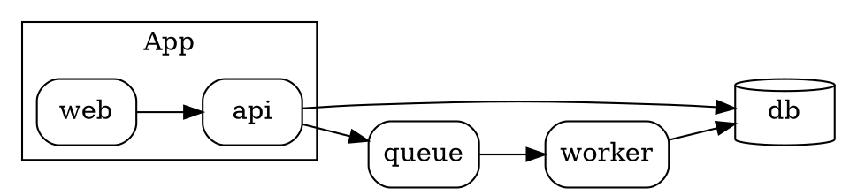

# Draw a graph from Graphviz or D2

This guide shows how to draw a graph from a source in the language of Graphviz or of D2, and
how to show its nodes and edges step by step. For each option, see
[The diagram element](../reference/diagram-element.md).

## Install the tool

The render runs the tool, so the computer that renders the deck needs it. The document holds
the SVG, so a browser that presents the deck does not need the tool.

| Tool | Program | Install |
| --- | --- | --- |
| Graphviz | `dot` | `brew install graphviz`, `apt-get install graphviz`, or https://graphviz.org/download/ |
| D2 | `d2` | `brew install d2`, or https://d2lang.com |

The render finds the program on the `PATH`. To use a program at a different place, give its
path in `EXPRESSO_DOT` or `EXPRESSO_D2`.

## Show a graph from Graphviz node by node

Write the graph in a `.dot` file next to the deck:



Write a `diagram` element with the path of the file. A `part` names a node by its name in the
source, and its `at` option gives its steps. An edge without a part shows from the step where
both of its nodes show, so the edges come with their nodes:

```elixir
defmodule Examples.GraphGraphviz do
  use Expresso

  root __DIR__

  slide "the system" do
    heading "The system"

    diagram "system.dot" do
      width "80%"

      part "api", at: [from: 2]
      part "db", at: [from: 3]
      part "queue", at: [from: 3]
      part "worker", at: [from: 4]
    end
  end
end

Examples.GraphGraphviz
```


The graph takes the colors and the font of the theme. A part of an edge has the name of its
two ends, such as `part "api->db"`, and a part of a cluster has the name of the subgraph,
such as `part "cluster_app"`.

## Show a graph from D2 with a container

Write the graph in a `.d2` file next to the deck:

```d2
direction: right

app: App {
  web
  api
  web -> api
}

db: {shape: cylinder}
queue: {shape: queue}

app.api -> db
app.api -> queue
queue -> worker
worker -> db: write
```

A part names a shape by its key in the source, with the keys of its containers, such as
`app.api`. A part of a container, such as `app`, can get a state at a step:

```elixir
defmodule Examples.GraphD2 do
  use Expresso

  root __DIR__

  slide "the system" do
    heading "The system"

    diagram "system.d2" do
      width "80%"

      part "app.api", at: [from: 2]
      part "db", at: [from: 2]
      part "queue", at: [from: 3]
      part "worker", at: [from: 3]

      part "app" do
        on 4, state: :alert
      end
    end
  end
end

Examples.GraphD2
```


D2 draws the graph with the layout engine ELK. For a large graph, `layout :dagre` is faster.

## Show an edge later than its nodes

Give the edge its own part. The name of an edge is the name of its two ends, with the arrow
of the source and no spaces:

```elixir
slide "a new link" do
  diagram "system.d2" do
    part "worker->db", at: [from: 2]
  end
end
```

With `edges :own`, each edge without a part shows at each step, as an element of an SVG file
does.

## Keep the colors of the tool

A graph takes the colors of the theme. For a graph with colors that have a meaning, keep the
colors of the tool:

```elixir
slide "the states" do
  diagram "states.dot" do
    colors :tool
  end
end
```

To change one color of the theme for a graph of D2, change its custom property with the
[css option](../reference/css-option.md), such as `.diagram-d2 { --graph-B4: var(--chart-4); }`.
[The colors and the font of a graph](../reference/diagram-element.md#the-colors-and-the-font-of-a-graph)
lists the properties.

## Give the graph the font of your theme

A graph takes the font of the built-in theme, and the tool sizes each box for that font. A
deck with a different font gives the TTF files of that font with the `font` option:

```elixir
slide "the system" do
  diagram "system.d2" do
    font "fonts/inter"
  end
end
```

The directory holds a TTF file for each style. A style without a file takes the regular file.
