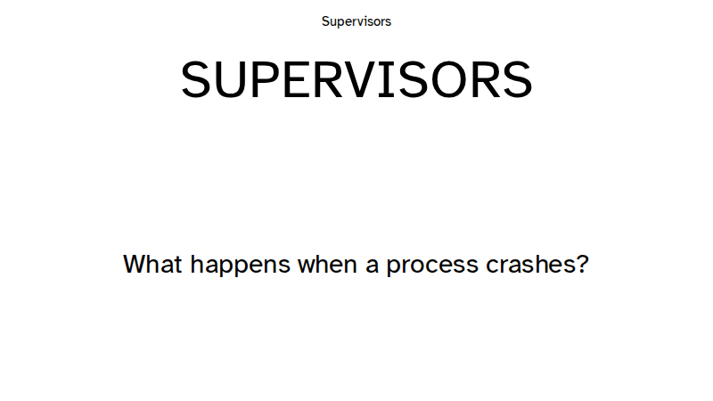
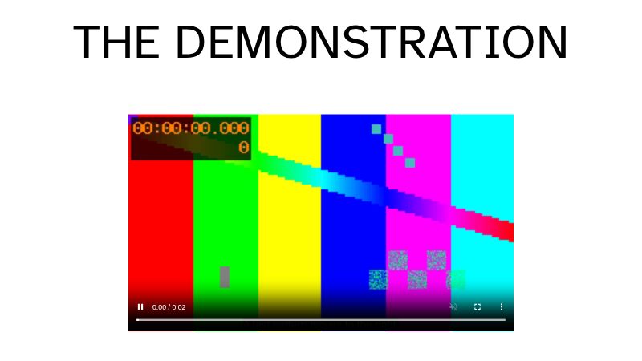
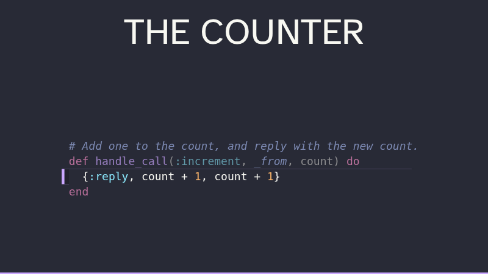

# Make a deck accessible

This guide shows how to make a deck that a screen reader can read and that a keyboard can
present. The document gives the structure itself. Your deck gives the names and the texts.
For each part of the document, see [The accessibility of a deck](../reference/accessibility.md).

## Give each slide a heading

A screen reader names each slide with its number and its heading, such as "Slide 2 of 3: A
restart". The live region reads that name at each move to the slide. Without a heading, the
name of the slide is its `slide` name, such as "restart". The menu shows the same names.

```elixir
defmodule Examples.Accessible do
  use Expresso

  name "Supervisors"

  slide "start" do
    heading "Supervisors"
    labels ["The question"]
    text_area(text: "What happens when a process crashes?")
  end

  slide "restart" do
    heading "A restart"
    labels ["The crash", "The restart"]

    list do
      reveal true
      item "The process crashes"
      item "The supervisor starts it again"
    end
  end

  slide "result" do
    heading "The result"

    stat 99.9 do
      suffix "%"
      label "of the time, the service answers"
    end
  end
end

Examples.Accessible
```



### A slide with no heading

A screen reader can move from heading to heading. A slide with no `h1`, such as a slide with
only a picture, gets an `h1` that only a screen reader reads. Its text is the name of the
slide, or "Slide 4 of 9" for a slide with no name. A slide template that writes its title in
an `h2` gets the hidden `h1` too.

When the hidden heading adds nothing, such as on a slide between two parts of the talk,
give `sr_heading false`:

```elixir
slide "pause" do
  sr_heading false
  image "photo.jpg"
end
```

Give the deck a `name` too. The browser and a screen reader show it as the title of the
document. A deck with no name takes the heading of its first slide as its title.

## Name the steps

The `labels` option of a slide names its steps. The menu shows each name, and a screen
reader reads it after the number of the step, such as "Step 1 The crash". A step without a
name is only "Step 2". See [Step labels](../reference/step-labels.md).

## Give each picture a text

A screen reader cannot see a picture, so give each one a text:

| Element | Option | Example |
| --- | --- | --- |
| `image` | `alt` | `alt "A supervisor with three workers"` |
| `diagram` | `alt` | `alt "A request goes from the browser to the server"` |
| `chart` | `title` | `title "Orders for each month"` |
| `stat` | `label` | `label "of the time, the service answers"` |
| `icon` | `label` | `label "Expresso"` |
| `qr_code` | `title` | `title "The address of the slides"` |
| `video`, `audio`, `embed` | `title` | `title "The demo of the restart"` |

An image without `alt` is decorative, and a screen reader does not read it. Leave out `alt`
only for an image that gives no information.

## Describe a diagram

A screen reader reads the text inside an SVG file, and that text is often a set of labels
with no order. Give the diagram an `alt` option to replace it with one description:

```elixir
diagram "examples/flow.svg" do
  alt "A request goes from the browser to the server, and back"
end
```

## Add captions to a video

Write the captions in a WebVTT file, and give its path in the `captions` option. The
browser shows each line at its time:

```elixir
defmodule Examples.VideoCaptions do
  use Expresso

  slide "the demonstration" do
    heading "The demonstration"

    video "examples/animations/clip.webm" do
      title "A test pattern that moves"
      poster "examples/animations/clip.png"
      captions "examples/animations/clip.vtt"
      controls true
      width "60%"
    end
  end
end

Examples.VideoCaptions
```



`examples/animations/clip.vtt` holds the captions:

```text
WEBVTT

00:00:00.000 --> 00:00:01.000
A test pattern moves to the right.

00:00:01.000 --> 00:00:02.000
The pattern moves on, and the clip starts again.
```

## Give the language of the deck

A screen reader reads an English deck with an English voice. For a deck in a different
language, give the `lang` option, so the screen reader selects the correct voice:

```elixir
lang "de"
```

See [the lang option](../reference/lang-option.md).

## Keep dimmed text readable

A dimmed element, such as a line of code out of focus, keeps a contrast of 3:1 on its
background. A slide usually shows large text, and 3:1 is the minimum of WCAG for large
text. For small text, such as a long listing, or for a deck that a checker must pass, give
the `dim_contrast` option:

```elixir
defmodule Examples.DimContrast do
  use Expresso

  theme :dracula
  dim_contrast 4.5

  slide "the counter" do
    heading "The counter"

    code "elixir" do
      text """
      # Add one to the count, and reply with the new count.
      def handle_call(:increment, _from, count) do
        {:reply, count + 1, count + 1}
      end
      """

      highlight [2..2, 3..3]
    end
  end
end

Examples.DimContrast
```



Each dimmed line now keeps 4.5:1, the minimum of WCAG for normal text. The lines dim less,
and the bar of `highlight` still shows the focus. See
[the dim_contrast option](../reference/dim-contrast-option.md).

A light built-in theme does not dim at 4.5, and the compiler gives a warning. For a light
theme, give `dim_contrast 4`, or give a theme with more contrast. See
[A theme that does not dim](../reference/dim-contrast-option.md#a-theme-that-does-not-dim).

A dimmed image, diagram, embed and video then do not dim either. To dim them and keep
4.5:1 for the text, give the opacity of a dimmed graphic:

```elixir
dim_contrast 4.5
dim_graphic_opacity 0.5
```

See [the dim_graphic_opacity option](../reference/dim-graphic-opacity-option.md).

## Look at the deck in forced colors

A user can ask the system for forced colors, such as the high contrast mode of Windows.
The browser then gives each text a color of the system. A deck needs no option for this
mode, but look at it one time, because the mode removes each color that has a meaning.

1. Open the deck in Chrome, and open the developer tools.
2. Open the command menu with `Ctrl+Shift+P`, or with `Cmd+Shift+P` on macOS, and run
   `Show Rendering`.
3. Set `Emulate CSS media feature forced-colors` to `forced-colors: active`.
4. Go through each step of the deck.

Look for these three things:

- A text that tells its meaning only with a color. The colors of code and the color of a
  `set` go away. Add a word, or the state `alert`. An `on` entity with the state
  `highlight` draws no mark. Only the `highlight` option of a code element draws a bar.
- A chart, a diagram, a formula with a part or an image. Each one keeps its colors on a
  plate with the background color of the theme, so it must be readable on that color.
- A color or a gradient as the background of a slide. It goes away, so the slide must make
  sense with no background. An image stays, and each text gets a box behind it.

See [Forced colors](../reference/accessibility.md#forced-colors) for each rule.

## Look at the deck with more contrast

A user can also ask the system for more contrast. The deck then gives each text 7:1 or
more on its background, and a dimmed text keeps 7:1. A deck needs no option for this
preference.

1. Open the developer tools of Chrome, and run `Show Rendering` in the command menu.
2. Set `Emulate CSS media feature prefers-contrast` to `prefers-contrast: more`.
3. Go through each step of the deck.

Look for a step that tells its meaning only with the state `dim`. A color near 7:1
does not dim, so the dimmed element can look the same as the current element. Add the
state `alert` to the current element. In a code element, give the `highlight` option, which
draws a bar at each line in focus.

See [More contrast](../reference/accessibility.md#more-contrast) for each change.

## Make sure of the result

1. Open the deck in a browser with a screen reader, such as VoiceOver on macOS or NVDA on
   Windows.
2. Press `j`. The screen reader reads the name of the next slide, or the next step.
3. Press `m`. The screen reader reads the name of the current step. Press `j` and `k` to
   move the cursor, and listen for each name.
4. Press `p` for the handout view. Each page has the name of its slide and its step.

To find a missing text, run a checker such as [axe DevTools](https://www.deque.com/axe/)
in the browser. A violation names the element and the rule.
