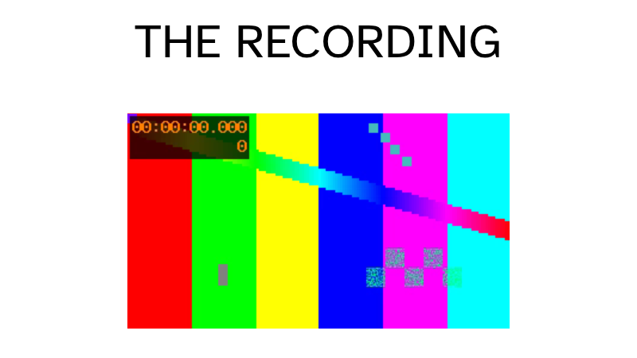

# Put a deck on a web host

This guide shows how to put a deck on a web host, and how to make sure that the host sends
it fast. GitHub Pages is the example of a host. For the option that keeps a file next to
the document, see [the external option](../reference/external-option.md).

## Render the deck into a directory

1. Make a directory for the files of the host. The render does not make it:

   ```sh
   mkdir -p site
   ```

2. Render the deck to the file `index.html` of that directory:

   ```sh
   mix expresso talk.exs site/index.html
   ```

   A host sends `index.html` for the address of its directory, so the address of the deck
   has no file name.

3. Find the files that go to the host:

   | File | When it is there |
   | --- | --- |
   | `site/index.html` | Always. It is the document of the deck. |
   | `site/index_files/` | When an `image`, a `video` or an `audio` element has `external true`. |

4. Put each file of `site/` on the host. Keep the directory `index_files/` next to
   `index.html`.

## Decide which files stay out of the document

A video file or a sound file is a part of the document, unless its element has
`external true`. Each viewer then gets the file with the document, also a viewer who does
not go to its slide. A deck with one video of 20 MB has a document of 27 MB. With
`external true`, the same document has 0.5 MB, and the browser asks for the video only
when its slide shows.

Give `external true` to each large video and to each large sound of a deck for a web
host. [Keep a long video next to the document](show-a-video.md#keep-a-long-video-next-to-the-document)
gives the steps, with this deck as its example:



An image file is also a part of the document. For a deck with many photographs, give the
`external` option to the deck. Each image, video and sound then stays out of the document:

```elixir
defmodule Talk do
  use Expresso

  external true

  slide "the team" do
    image "team.jpg", alt: "The team in front of the office"
  end
end
```

A deck with 40 photographs of 500 KB has a document of approximately 27 MB. With the
option, the document holds only the address of each photograph. The browser gets each
photograph one time, and the host can keep it in its cache, so a change of the text of the
deck does not send the photographs again.

To keep one small file in the document, give `external false` to its element. See
[the external option](../reference/external-option.md).

## Give the deck a description

A search engine shows the title of a page and a description under it. The title is the
`name` option of the deck. Give the description with the `description` option:

```elixir
defmodule Talk do
  use Expresso

  name "Supervision trees in practice"
  description "How a supervision tree starts a process again after a failure, in ten slides."
  author "Ada Lovelace"

  slide do
    heading "Supervision trees in practice"
  end
end
```

1. Write one or two sentences that tell what the talk is about. A search engine shows
   approximately 155 characters.
2. Render the deck again.
3. Make sure that the document has the tag:

   ```sh
   grep -o '<meta name="description"[^>]*>' site/index.html
   ```

A deck with no `description` option has no description, and Lighthouse then gives 90 for
SEO, and not 100. See
[the description and author options](../reference/description-option.md).

## Make sure that the host compresses the document

The document is text, and compression makes it approximately half as large.

1. Get the size that the host sends to a browser:

   ```sh
   curl -s -o /dev/null -H 'Accept-Encoding: gzip, br' -w '%{size_download} bytes\n' https://example.com/talk/
   ```

2. Get the size of the document with no compression:

   ```sh
   curl -s -o /dev/null -w '%{size_download} bytes\n' https://example.com/talk/
   ```

3. Compare the two numbers. For a deck of one slide, the first command gave `133747 bytes`
   and the second gave `273148 bytes`. When the two numbers are the same, the host does
   not compress the document. Turn on gzip or Brotli for HTML in the settings of the host.

## Make sure that a viewer can go to a time of a video

A browser asks for a part of a video file when the viewer goes to a time of the video.
The host must answer such a range request.

1. Find the name of the copy in `site/index_files/`, such as `clip-3dc53cfe.webm`.
2. Ask the host for the first 100 bytes of the file:

   ```sh
   curl -s -o /dev/null -H 'Range: bytes=0-99' -w '%{http_code} %{size_download} bytes\n' https://example.com/talk/index_files/clip-3dc53cfe.webm
   ```

3. Read the answer. `206 100 bytes` is correct. An answer with `200` and the size of the
   whole file shows that the host does not answer a range request. The video then plays,
   but the viewer can go to a time only after the browser has the whole file.

## Give the files of the directory a long cache time

The name of each file of `index_files/` holds a hash of its content. A file that changes
gets a new name, so a browser can keep a file with one name for a long time. The document
changes with each change of the deck, so its cache time must be short.

1. Read the cache time that the host gives a file:

   ```sh
   curl -s -o /dev/null -D - https://example.com/talk/index_files/clip-3dc53cfe.webm | grep -i cache-control
   ```

2. Set these headers in the settings of the host, when the host lets you set them:

   | Files | Header |
   | --- | --- |
   | `index_files/*` | `Cache-Control: max-age=31536000, immutable` |
   | `index.html` | `Cache-Control: no-cache` |

## Use GitHub Pages as the host

GitHub Pages publishes the root of a branch, or the directory `docs/` of a branch.

1. Render the deck into `docs/` in your repository:

   ```sh
   mkdir -p docs
   mix expresso talk.exs docs/index.html
   ```

2. Add an empty file `.nojekyll`, so GitHub Pages publishes the files as they are:

   ```sh
   touch docs/.nojekyll
   ```

3. Commit the directory `docs/`, and push the branch.
4. Select the branch and the directory `/docs` as the source of GitHub Pages in the
   settings of the repository.
   [Configuring a publishing source for your GitHub Pages site](https://docs.github.com/en/pages/getting-started-with-github-pages/configuring-a-publishing-source-for-your-github-pages-site)
   gives the steps.
5. Do the three checks of this guide with the address of the deck, such as
   `https://example.github.io/talk/`.

GitHub Pages gave these answers on 2026-11-15:

| Check | Answer of GitHub Pages |
| --- | --- |
| Compression | gzip. It does not send Brotli. |
| Range request | `206`, so a viewer can go to a time of a video. |
| Cache time | `Cache-Control: max-age=600` for each file. You cannot change it. |

GitHub Pages has limits. A site has a soft limit of 100 GB of traffic in one month, and
Git refuses a file that is larger than 100 MB.
[GitHub Pages limits](https://docs.github.com/en/pages/getting-started-with-github-pages/github-pages-limits)
gives each limit.

## Measure the result

Lighthouse measures the load of the first slide on a slow phone.

1. Run Lighthouse with the address of the deck. It needs Node and Chrome:

   ```sh
   npx lighthouse https://example.com/talk/ --only-categories=performance --view
   ```

2. Read these three numbers of the report:

   | Number | What it tells you |
   | --- | --- |
   | First Contentful Paint | The time until the first slide shows. |
   | Cumulative Layout Shift | How much the slide moves after it shows. The correct value is 0. |
   | The total size, in the audit about network payloads | The bytes that the browser gets for the first slide. A video with `external true` is not a part of them. |

Lighthouse does not measure when the deck answers a key. The presenter starts as soon as
the browser has the slides, before it has a video file of the document.
