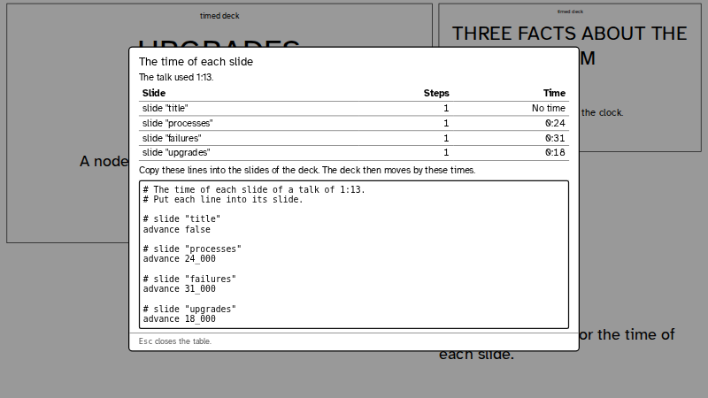

# Rehearse a talk and record the time of each slide

This guide shows how to measure the time that each slide of a talk needs, and how to give
those times to the deck. The deck then goes to each next step by itself. The guide uses
the deck of [Run a deck by time](run-a-deck-by-time.md).

## Record the times

1. Add `?rehearse` to the address of the deck, such as `deck.html?rehearse`. The clock of
   the steps then does not run, so a deck that already has times waits for your keys.
2. Press `s` for the speaker view. It shows
   `Rehearsal. Press e for the time of each slide.` under the timer.
3. Give the talk. Press `j` at the end of each step. The timer starts at your first `j`,
   so the title has no time.
4. Press `e` in the speaker view. A table shows the time of each slide.



Press `Esc` to close the table. You can then continue the talk, and a second `e` shows the
times to that point. Press `r` to set the timer to 0:00 and to start a new record.

## Give the times to the deck

1. Click the lines under the table. One click selects each line.
2. Copy the lines, and close the table with `Esc`.
3. Put each `advance` line into the slide that the comment above it names:

   ```elixir
   slide "processes" do
     advance 24_000
     heading "Processes"
   end
   ```

4. Make the HTML document again, and open it with no `?rehearse`.

The lines follow these rules:

| Line | Meaning |
| --- | --- |
| `advance 24_000` | Each step of the slide has 24 seconds. A time is a number of full seconds. |
| `advance [12_000, 8_000]` | Step 1 has 12 seconds, and step 2 has 8 seconds. |
| `advance false` | You did not show the slide while the timer ran. The slide waits for a key. |

A slide with `advance false` in the middle of a talk stops the deck. Give that slide a
time, or rehearse it again.

## Look at the times of a talk with an audience

The speaker view records the times of each talk, with or without `?rehearse`. Press `e`
after the talk to see the time that each slide used.

For each rule, see [The time of each slide](../reference/presenter.md#the-time-of-each-slide)
and [the advance option](../reference/advance-option.md).
