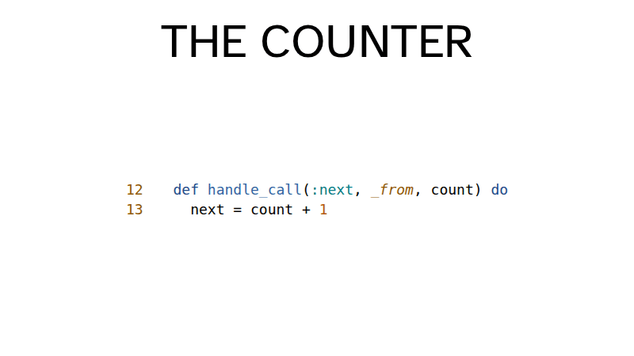

# Render a deck in your project

This guide shows how to keep a deck in your own project, give its paths from the project,
render it with `mix expresso` or with the binary, and give an AI agent the rules of the
DSL. For each value of the option, see
[The root option](../reference/root-option.md).

## Give each path from your project

1. Put the deck file in your project, such as `talk/deck.exs`.
2. Give the deck the `root` option with the directory of your project. In the deck file,
   `__DIR__` is the directory of the file, so the directory above it is the project:

   ```elixir
   defmodule MyTalk.Deck do
     use Expresso

     root Path.expand("..", __DIR__)

     slide "the server" do
       code "elixir" do
         src "lib/my_app/server.ex"
         lines from: "def handle_call(", to: :block
       end
     end
   end
   ```

3. Write each path of the deck from the project, such as `"lib/my_app/server.ex"`. An image,
   a diagram, an embed and the `css` option take their paths from `root` too.

The deck then renders from any directory.

## Render the deck with mix expresso

1. Add Expresso to the dependencies of your project, for the environment `dev` only:

   ```elixir
   defp deps do
     [
       {:expresso, github: "rellen/expresso", only: :dev, runtime: false}
     ]
   end
   ```

2. Fetch the dependencies:

   ```sh
   mix deps.get
   ```

   The first compile gets the library of MDEx, which makes the notes of the speaker,
   from GitHub.

3. Render the deck from the directory of your project:

   ```sh
   mix expresso talk/deck.exs talk/deck.html
   ```

4. To render the deck again after each change, add `--watch`, and open
   `http://127.0.0.1:4100/`:

   ```sh
   mix expresso talk/deck.exs --watch
   ```

Your project does not start Expresso, and a release of your project does not hold it.

## Give an AI agent the rules of Expresso

An AI agent that writes a deck in your project does not know the DSL of Expresso. The
package holds the file `usage-rules.md`, which gives an agent the shape of a deck, the
elements, the steps and the commands. The package
[usage_rules](https://hexdocs.pm/usage_rules) copies that file into the file that your
agent reads, such as `AGENTS.md` or `CLAUDE.md`.

1. Add `usage_rules` to the dependencies of your project:

   ```elixir
   defp deps do
     [
       {:expresso, github: "rellen/expresso", only: :dev, runtime: false},
       {:usage_rules, "~> 1.3", only: :dev}
     ]
   end
   ```

2. Give the file and the package in the `project` function of `mix.exs`:

   ```elixir
   def project do
     [
       app: :my_app,
       deps: deps(),
       usage_rules: [file: "AGENTS.md", usage_rules: [:expresso]]
     ]
   end
   ```

3. Fetch the dependencies, and write the file:

   ```sh
   mix deps.get
   mix usage_rules.sync
   ```

`AGENTS.md` then holds the rules between two comments. Run `mix usage_rules.sync` again
after an update of Expresso. To keep `AGENTS.md` short, give
`usage_rules: [{:expresso, link: :markdown}]`, and the file holds a link to
`deps/expresso/usage-rules.md`.

## Render the deck with the binary

The binary needs no Elixir, so a computer with no Elixir can render the deck.

1. Make the binary, as [Make a binary](https://github.com/rellen/expresso/blob/main/docs/development/release.md#make-a-binary) tells, and copy it
   to a directory on your path.
2. Render the deck:

   ```sh
   expresso_cli_app_linux_x86 talk/deck.exs talk/deck.html
   ```

The binary takes the same arguments as `mix expresso`, `--watch` too, and it gives the same
exit status. Its usage text has the file name of the binary, such as
`Usage: expresso_cli_app_linux_x86 <input> [output]`.

The binary can write only a part of the HTML to a pipe that does not block, when the reader
of the pipe is slow. The exit status is then 0. Give an output path, or write the standard
output to a file with `> deck.html`, to get all the HTML.

## The complete deck

This deck is next to the file `examples/animations/counter.ex`, so its root is `__DIR__`.
It shows the function `handle_call/3` of the file in two groups:

```elixir
defmodule Examples.ProjectRoot do
  use Expresso

  root __DIR__

  slide "the counter" do
    heading "The counter"

    code "elixir" do
      src "counter.ex"
      lines from: "def handle_call(", to: :block
      line_numbers true
      reveal [12..13, 14..15]
    end
  end
end

Examples.ProjectRoot
```


