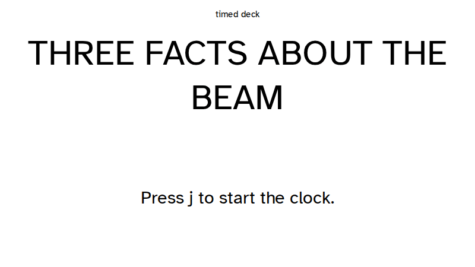

# Run a deck by time

This guide shows how to make a deck go to the next step after a time, for a talk with a
fixed time for each slide and for a deck on a screen at a stand.

## Give each step a time

Write `advance` in the deck, with a time in milliseconds:

```elixir
defmodule Examples.TimedDeck do
  use Expresso

  name "timed deck"
  advance 20_000
  loop true

  slide "title" do
    advance false
    heading "Three facts about the BEAM"

    text_box do
      text_area(text: "Press j to start the clock.")
    end
  end

  slide "processes" do
    heading "Processes"

    text_box do
      text_area(text: "A process is small, so a node can run millions of them.")
    end
  end

  slide "failures" do
    heading "Failures"

    text_box do
      text_area(text: "A supervisor starts a process again after a failure.")
    end
  end

  slide "upgrades" do
    advance 10_000
    heading "Upgrades"

    text_box do
      text_area(text: "A node can load new code while it runs.")
    end
  end
end

Examples.TimedDeck
```



Each step now shows for 20 seconds, and the present view then goes to the next step. These
rules apply to the example:

- The slide "title" has `advance false`, so it waits for a key. You can open the deck
  before the talk, and the clock starts when you press `j`.
- The slide "upgrades" has `advance 10_000`, so it shows for 10 seconds.
- The deck has `loop true`, so the title shows again after the last slide.

The time is the time of one step. A slide with three steps and `advance 20_000` shows for
one minute.

## Stop the clock during a talk

1. Press `a` in the present view or in the speaker view. The clock stops, and the step
   waits.
2. Answer the question. The keys `j` and `k` still move.
3. Press `a` again. The step continues its time.

A black screen from the key `b` also stops the clock until the slide shows again.

## See the time left

Press `s` for the speaker view. It shows the time left of the step under the timer, such
as `Next step in 0:12`. While the clock is stopped, it shows
`Clock stopped, 0:12 to the next step`.

## Run a deck on a screen with no presenter

1. Give the deck `advance` and `loop true`. Do not give a slide `advance false`, because
   no presenter is there to press a key.
2. Open the HTML file in a browser on the screen.
3. Press `f` for full screen.

The deck then shows each step for its time, and it starts again after the last slide. A
video or a sound plays to its end before its step ends.

## Open a deck with the clock stopped

Add `?paused` to the address:

```
deck.html?paused
```

The clock is then stopped at the load. Press `a` to start it. Use this address to
practice a talk at your own speed.

For each value and each rule, see
[the advance option and the loop option](../reference/advance-option.md).
