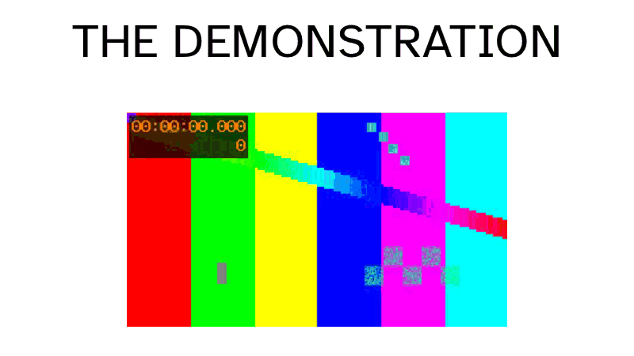
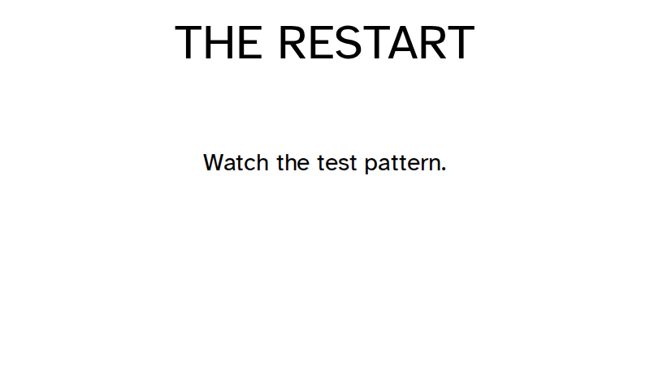
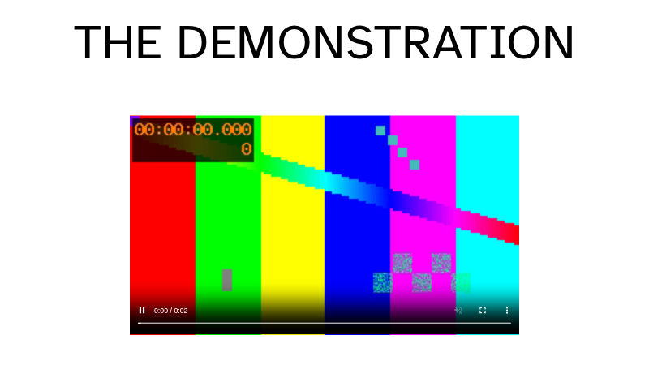
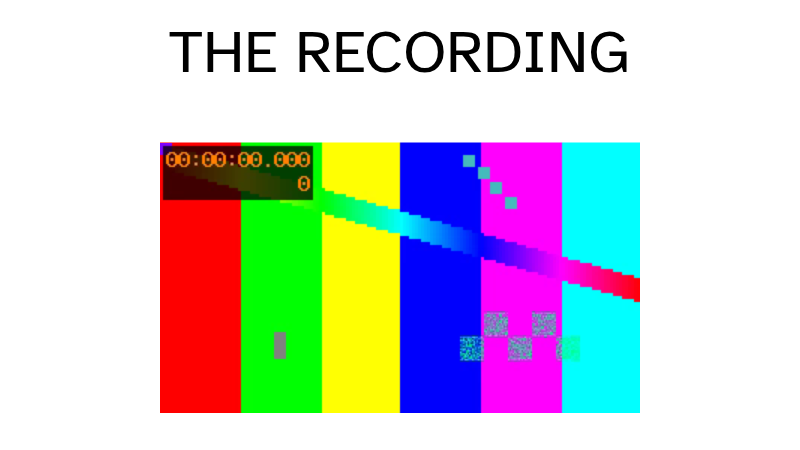

# Show a video

This guide shows how to play a video file in a slide. The document holds each video file
one time, and paper and the handout view show a poster image in its place. For each
option, see [The video element](../reference/video-element.md).

## Show a video in a slide

Write a `video` element with the path of a WebM or an MP4 file, a `title` and a `poster`
image. The video plays in the present view while its slide shows, and it plays again from
the start at its end. The key `p` opens the handout view, which shows the poster and the
notes:

```elixir
defmodule Examples.Video do
  use Expresso

  slide "the demonstration" do
    heading "The demonstration"
    notes "The handout view and paper show the poster in place of the video."

    video "examples/animations/clip.webm" do
      title "A test pattern that moves"
      poster "examples/animations/clip.png"
      width "60%"
    end
  end
end

Examples.Video
```



## Make the video file and the poster

A browser plays a WebM file and an MP4 file with no plugin. Use these steps to make the
two files from a screen recording, such as `demo.mov`:

1. Make a WebM file with no sound:

   ```sh
   ffmpeg -i demo.mov -an -c:v libvpx-vp9 -b:v 0 -crf 40 demo/demo.webm
   ```

2. Make the poster from the first frame:

   ```sh
   ffmpeg -i demo/demo.webm -frames:v 1 demo/demo.png
   ```

A higher `-crf` value gives a smaller file. The document holds the file as base64 text,
which is approximately a third larger than the file.

## Start a video at a step

Write `at` in the video, as for each other element. The video shows and starts to play at
that step. In this deck, the key `j` shows the video at step 2:

```elixir
defmodule Examples.VideoAt do
  use Expresso

  slide "the restart" do
    heading "The restart"
    steps 2

    text_box do
      text_area(text: "Watch the test pattern.")
    end

    video "examples/animations/clip.webm" do
      at 2
      title "A test pattern that moves"
      poster "examples/animations/clip.png"
      width "50%"
    end
  end
end

Examples.VideoAt
```



A black screen, the menu and the overview pause the video, and it goes on from the same
time after them. A move to another slide pauses it, and a move back starts it from the
start.

## Let the presenter turn the sound on

A browser starts a video with sound only after a click, so the video has no sound. Write
`controls true` to show the controls of the browser:

```elixir
defmodule Examples.VideoControls do
  use Expresso

  slide "the demonstration" do
    heading "The demonstration"

    video "examples/animations/clip.webm" do
      title "A test pattern that moves"
      poster "examples/animations/clip.png"
      width "60%"
      controls true
    end
  end
end

Examples.VideoControls
```



The controls take the clicks on the video, so a click on the video does not go to the next
step. A click on another part of the slide still does.

## Keep a long video next to the document

The document holds each video file, so a long recording makes a large document, and the
first slide waits for the whole file. Write `external true` to keep the file next to the
document:

```elixir
defmodule Examples.VideoExternal do
  use Expresso

  slide "the recording" do
    heading "The recording"

    video "examples/animations/clip.webm" do
      title "A test pattern that moves"
      poster "examples/animations/clip.png"
      width "60%"
      external true
    end
  end
end

Examples.VideoExternal
```



1. Give the command an output file, such as `mix expresso talk.exs talk.html`. The
   standard output has no directory for the file.
2. Find the copy of the video in the directory `talk_files/`, next to `talk.html`. Its
   name holds a hash of its content, such as `clip-3dc53cfe.webm`.
3. Put the document and the directory on the web host together.

The browser then asks for the video only when its slide shows, and it can go to a time of
the video before the whole file arrives. The poster stays in the document, so the speaker
view and the handout view show it with no file.

An `audio` element takes the same option. For each rule, see
[A file next to the document](../reference/video-element.md#a-file-next-to-the-document).
