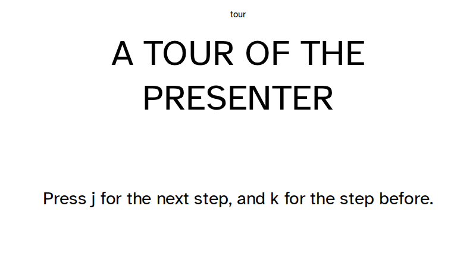
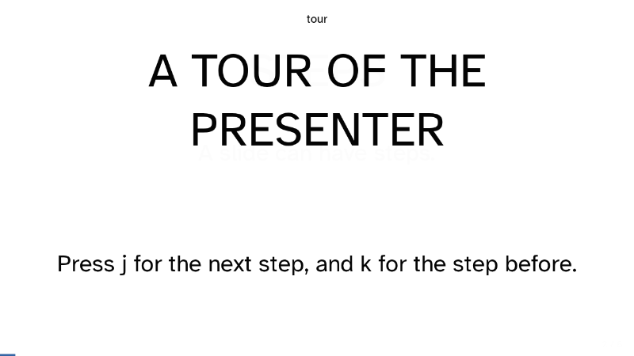
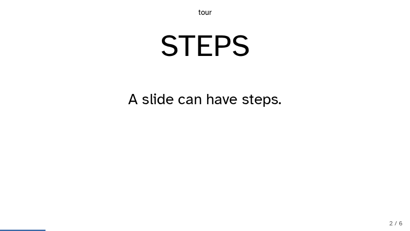
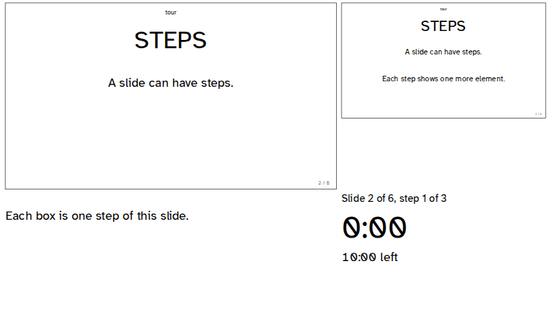
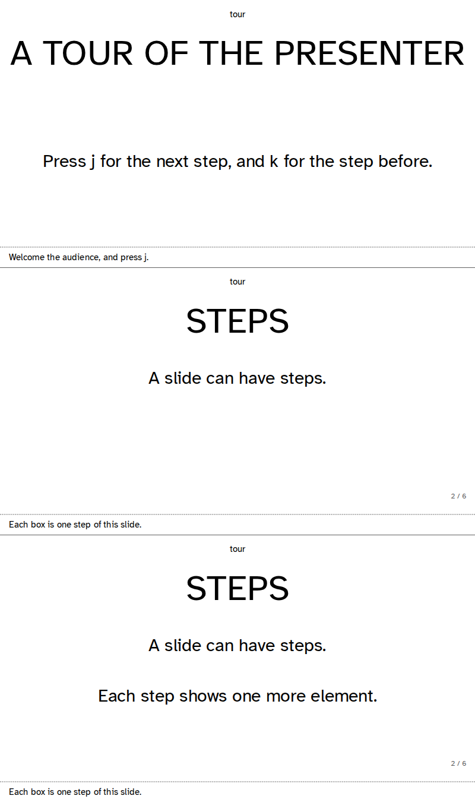
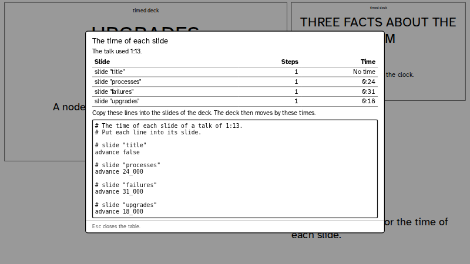
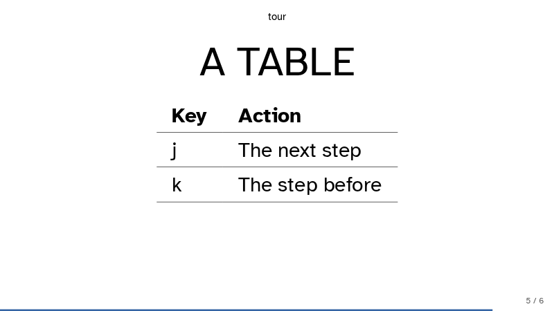
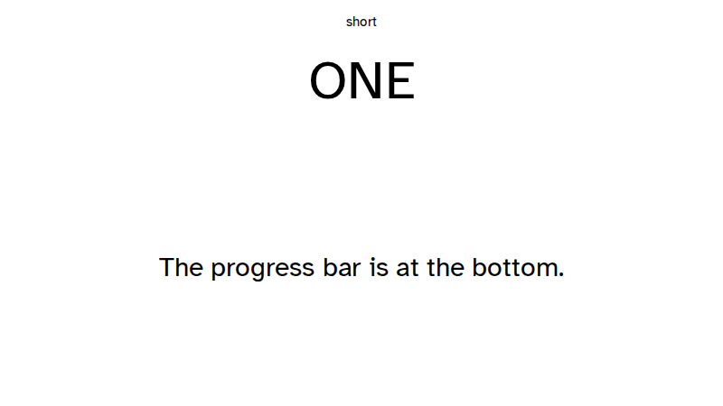
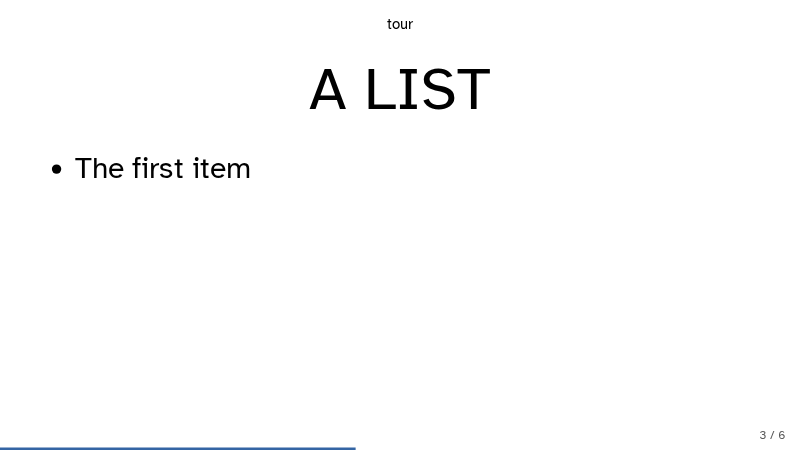

# The presenter

This page describes each view of the presenter, its keys, and the parts of the address.
The HTML document holds the presenter, so a browser needs no other file to present the
deck. For the steps of a talk, see [Present a deck](../how-to/present-a-deck.md).

## The views

| View | Opens with | Shows |
| --- | --- | --- |
| Present view | The address of the document | The current step, for the audience |
| Overview | `o` | Each slide at its last step, in a grid |
| Menu | `m` | Each slide and its steps, in a list |
| Speaker view | `s` | The current step, the next step, the notes and a timer, in a second window |
| Handout view | `p` | One page for each step, for a printer |

`?` or `/` opens the search of the keys in each view. The keys of the current view come
first, in groups. The keys of each other view are in a closed section below them.

## The present view

The present view knows these keys:

<!-- keys present -->

| Key | Action |
| --- | --- |
| `j`, `→`, `↓`, `Page Down`, `Space` | Next step, or the first step of the next slide |
| `k`, `←`, `↑`, `Page Up` | Previous step, or the last step of the previous slide |
| `Home` | First slide |
| `End` | Step 1 of the last slide |
| 0 to 9 | Type a slide number |
| `Enter` | Step 1 of the slide that you typed |
| `a` | Stop or start the clock of the steps, in the two windows. A step with a time of the advance option goes to the next step only while the clock runs. |
| `o` | Overview of the slides. Only this window shows it. |
| `m` | Menu of the slides and their steps. Only this window shows it. |
| `b` | Black screen. The next key shows the slide again. |
| `w` | White screen. The next key shows the slide again. |
| `d` | Code and charts in full color until the next step, in the two windows |
| `t` | Light or dark variant of the theme, in the two windows |
| `g` | Progress bar on or off |
| `f` | Full screen on or off |
| `s` | Speaker view, in a second window |
| `p` | Handout view |
| `?`, `/` | The search of the keys and commands. Esc closes it. |
| Click or tap the right two thirds, or swipe left | Next step |
| Click or tap the left third, or swipe right | Previous step |
| Click or tap a link | The slide and the step of the link |
| `l` | Laser pointer on or off, in the two windows. A red dot goes with the mouse or with your finger until the next step, and a click does not change the step. |
| `x` | Drawing on or off, in the two windows. A drag of the mouse or of your finger draws a line on the slide, and a click does not change the step. |
| `h` | Highlighter or pen for the next line of the drawing |
| `c` | Remove the drawing of the slide, in the two windows |
| `z` | Zoom on or off, in the two windows. A click then makes the part of the slide under the mouse fill the window, and the next click shows the full slide. A click with the Alt key does the same while the zoom is off. |
| `Esc` | Show the full slide again after a zoom, in the two windows |

<!-- /keys -->

To go to a slide, type its number, then press `Enter`. For example, `1` `2` `Enter` goes
to slide 12. The number shows in the top right corner until `Enter`.

A slide with `hidden true` is not a part of the talk. The keys above skip it, and the
numbers count only the slides of the talk. The overview, the menu and a link go to it. See
[the hidden option](hidden-option.md).

A presentation remote sends `Page Down` and `Page Up`, so it works with the deck.



### The mouse and the touch screen

A click or a tap on the right two thirds of the window goes to the next step. A click or a
tap on the left third goes to the previous step. On a touch screen, swipe left for the next
step, and swipe right for the previous step. A click on a link of the `goto` option goes to
its slide and step. A click on another link goes to the link.

## The overview

The overview shows each slide at its last step, in a grid that fits the window. A hidden
slide has a dashed outline and a lower opacity. In the speaker view, only the speaker
window shows the overview. The overview knows these keys:

<!-- keys overview -->

| Key | Action |
| --- | --- |
| `?`, `/` | The search of the keys and commands. Esc closes it. |
| `j`, `→`, `Page Down`, `Space` | Select the next slide |
| `k`, `←`, `Page Up` | Select the previous slide |
| `↓` | Select the slide below |
| `↑` | Select the slide above |
| `Home` | Select the first slide |
| `End` | Select the last slide |
| `Enter` | Step 1 of the selected slide |
| Click or tap a slide | Step 1 of that slide |
| `o`, `Esc` | Close the overview. The step does not change. |

<!-- /keys -->



## The menu

The menu lists each slide with a small picture of its last step, and the steps of each
slide under it. A step shows its number and its label. See [Step labels](step-labels.md).
A hidden slide shows a dash in the place of its number.
`m` opens the menu with the cursor at the current step, and the step of the audience
changes only at `Enter` or at a click. In the speaker view, only the speaker window shows
the menu. The menu knows these keys:

<!-- keys menu -->

| Key | Action |
| --- | --- |
| `?`, `/` | The search of the keys and commands. Esc closes it. |
| `j`, `↓` | Move the cursor to the next step |
| `k`, `↑` | Move the cursor to the previous step |
| `Enter` | The step of the cursor |
| Click or tap a step or a slide | That step |
| `m`, `Esc` | Close the menu. The step does not change. |

<!-- /keys -->



## The speaker view

The speaker view shows the current step, the next step, the notes of the current step,
the position and a timer. The notes are the `notes` option of the slide and each `note` of
the step, with their Markdown. See [The note element](note-element.md). The position ends with the label of the step, when the slide gives
one. The keys operate in either window, and the two windows show the same step. `b` in the
speaker view gives a black screen to the audience, and `w` gives a white screen. A white
screen follows each rule of a black screen: it pauses a video and a sound, and the next key
or click closes it. The speaker view knows these keys:

<!-- keys speaker -->

| Key | Action |
| --- | --- |
| `j`, `→`, `↓`, `Page Down`, `Space` | Next step, or the first step of the next slide |
| `k`, `←`, `↑`, `Page Up` | Previous step, or the last step of the previous slide |
| `Home` | First slide |
| `End` | Step 1 of the last slide |
| 0 to 9 | Type a slide number |
| `Enter` | Step 1 of the slide that you typed |
| `a` | Stop or start the clock of the steps, in the two windows. A step with a time of the advance option goes to the next step only while the clock runs. |
| `o` | Overview of the slides. Only this window shows it. |
| `m` | Menu of the slides and their steps. Only this window shows it. |
| `b` | Black screen. The next key shows the slide again. |
| `w` | White screen. The next key shows the slide again. |
| `d` | Code and charts in full color until the next step, in the two windows |
| `t` | Light or dark variant of the theme, in the two windows |
| `f` | Full screen on or off |
| `r` | Set the timer to 0:00, and remove the recorded time of each slide |
| `e` | The time of each slide of this talk, with the lines of the advance option for the deck |
| `?`, `/` | The search of the keys and commands. Esc closes it. |
| Click or tap the right two thirds, or swipe left | Next step |
| Click or tap the left third, or swipe right | Previous step |
| `l` | Laser pointer on or off, in the two windows. A red dot goes with the mouse or with your finger until the next step, and a click does not change the step. |
| `x` | Drawing on or off, in the two windows. A drag of the mouse or of your finger draws a line on the slide, and a click does not change the step. |
| `h` | Highlighter or pen for the next line of the drawing |
| `c` | Remove the drawing of the slide, in the two windows |
| `z` | Zoom on or off, in the two windows. A click then makes the part of the slide under the mouse fill the window, and the next click shows the full slide. A click with the Alt key does the same while the zoom is off. |
| `Esc` | Show the full slide again after a zoom, in the two windows |

<!-- /keys -->

The timer starts at the first change of the step after the speaker view opens. A second `s`
shows the open speaker view again, and its timer continues.

### The time of the talk

The `duration` option of the deck gives the length of the talk in minutes. The speaker view
then shows the time left under the timer. The time left turns amber when the presenter is
more than one minute behind, and red after the end of the time.

Each step gets the same part of the time. The presenter is behind when the presenter used
more time than the steps before the current step get.



## The handout view

The handout view shows one page for each step of each slide. A printer gets this view with
no key. In this view, only these keys operate, so the other keys scroll the pages:

<!-- keys handout -->

| Key | Action |
| --- | --- |
| `j` | Next step. The present view then shows it. |
| `k` | Previous step. The present view then shows it. |
| `p` | Present view |
| `a` | Every step, or the steps of the handout option. A print shows the same. |
| `?`, `/` | The search of the keys and commands. Esc closes it. |

<!-- /keys -->



A slide can select the steps that get a page, with the forms of `at`:

```elixir
slide "overlays" do
  handout [3, :last]
  # ...
end
```

`handout :last` gives the last step only, and `handout :all` gives each step. `:last` can
also go in a list, such as `[2, :last]`. Write `handout :last` in the deck to give only the
last step of each slide that has no `handout` option. The handout view on a screen shows the
same pages as the paper. The speaker view still shows each step.

`a` shows each step of each slide, whatever the `handout` options select. A print or a PDF
from that window gets the same pages. A second `a` shows the selection again.

The command line writes the same PDF with no window:
`mix expresso deck.exs --pdf handout.pdf --pdf-pages handout`. See
[The export options](export-options.md).

The handout view and paper leave out each hidden slide, and `a` does not show it. The deck
option `handout_hidden true` puts each hidden slide in. See
[the hidden option](hidden-option.md#the-handout-view-and-paper).

## The address

The address of the document holds the slide and the step, and it can hold these
parameters:

| Part | Example | Effect |
| --- | --- | --- |
| `#<slide>.<step>` | `deck.html#4.2` | Step 2 of slide 4. A reload shows the same step. The slide is the place of the slide in the deck, so a hidden slide counts. |
| `?scheme=` | `deck.html?scheme=dark` | The `dark` or the `light` variant of a theme. See [Give a deck a light and a dark variant](../how-to/give-a-deck-two-variants.md). |
| `?duration=` | `deck.html?duration=15` | The length of the talk in minutes. It replaces the `duration` option of the deck. |
| `?all` | `deck.html?all` | The handout view with each step, as after `a`. |
| `?paused` | `deck.html?paused` | The clock of the steps is stopped at the load, as after `a`. See [the advance option](advance-option.md). |
| `?rehearse` | `deck.html?rehearse` | A rehearsal: the clock of the steps does not run. See [The time of each slide](#the-time-of-each-slide). |
| `?check` | `deck.html?check` | The layout check. See [the layout check](layout-check.md). |

A step that the slide does not have shows the nearest step of that slide, so an old link
still opens the right slide after the slide loses a step.

## The clock of the steps

A deck with [the advance option](advance-option.md) gives each step a time, and the
present view goes to the next step when that time ends. For the design, see
[The timed advance](../timed-advance.md).

| Key | Effect |
| --- | --- |
| `a` | Stop or start the clock, in the two windows. |

These rules apply:

- A new step starts its time from zero, after a move of the clock and after a key.
- A clock that starts again continues the time of its step.
- A black screen stops the clock until the slide shows again.
- The speaker view shows the time left of the step, such as `Next step in 0:12`.
- With the deck option `loop true`, the clock and the keys of the next step go from the
  last slide to the first slide.
- In a deck with no `advance` option, the key `a` has no effect that you can see.

## The time of each slide

The speaker view records the time that each step used, while its timer runs. The key `e`
in the speaker view shows a table with the time of each slide, and the lines of
[the advance option](advance-option.md) for those times. For the design, see
[The rehearsal](../rehearsal.md).



| Key or address | Effect |
| --- | --- |
| `e` | The table of the time of each slide, in the speaker view. `Esc` or a click outside the table closes it. |
| `r` | Set the timer to 0:00, and start a new record. |
| `?rehearse` | A rehearsal: the clock of the steps does not run, in the two windows. |

These rules apply:

- The record starts with the timer, at the first change of the step. The step that shows
  before that change has no time.
- A step that shows a second time adds to its time.
- The table shows the sum of the steps of each slide, and `No time` for a slide that did
  not show while the timer ran. A hidden slide has the word `hidden` after its name.
- The lines give each slide its `advance` option, under a comment with the name of the
  slide. One click on the lines selects each of them.
- A time in the lines is the nearest full second, and one second at least. A slide with
  no time gets `advance false`. A slide whose steps have different times gets a list.
- While the table shows, a key goes to the browser, so the step does not change.
- A reload of the speaker view starts a new record.

## The laser pointer

The key `l` in the present view or in the speaker view turns the laser pointer on. A red
dot then goes with the mouse, or with your finger on a touch screen, in the two windows.
For the design, see [The laser pointer](../laser-pointer.md).


These rules apply:

- The dot in one window is on the same part of the slide in the other window. In the
  speaker view, point at the page of the current step.
- While the pointer is on, a click, a tap or a swipe moves the dot, and it does not change
  the step. The keys still change the step.
- A change of the step turns the pointer off. A second `l` also turns it off.
- The dot goes away when the mouse leaves the slide.
- The slide does not show the cursor of the system while the pointer is on.
- The overview, the menu, a black screen, the handout view and paper show no dot. A screen
  reader reads no change.

## The drawing

The key `x` in the present view or in the speaker view turns the drawing on. A drag of
the mouse, or of your finger on a touch screen, then draws a line on the slide, in the two
windows. For the design, see [The drawing](../drawing.md).


| Key | Effect |
| --- | --- |
| `x` | The drawing on or off. |
| `h` | The highlighter or the pen for the next line. The pen is the tool at the start. |
| `c` | Remove the drawing of the slide. |

These rules apply:

- A line in one window is on the same part of the slide in the other window. In the
  speaker view, draw on the page of the current step.
- While the drawing is on, a click, a tap or a swipe draws, and it does not change the
  step. The keys still change the step.
- The drawing stays through the steps of its slide. A change of the slide removes it, and
  it does not come back with the slide.
- The key `x` turns the laser pointer off, and the key `l` turns the drawing off.
- The overview, the menu, a black screen, the handout view and paper show no drawing. A
  screen reader reads no change.

## The zoom

A click with the Alt key on a slide of the present view or of the speaker view zooms: the
part of the slide under the mouse fills the window, in the two windows. For the design,
see [The zoom](../zoom.md).



| Key or click | Effect |
| --- | --- |
| Click with the Alt key | Zoom to the part of the slide under the mouse. The next such click shows the full slide. |
| `z` | The zoom of a click with no key, on or off. |
| `Esc` | The full slide. |

The part of the slide comes from the element under the mouse:

- The text, the pictures and the tables of the element fill the window in one direction,
  with a small margin. The scale is not more than 4.
- A click outside each element zooms by the factor 2 around the point. So does a click on
  an element that already takes most of the slide, such as a long sentence.

These rules apply:

- The same part of the slide fills each window. In the speaker view, click on the page
  of the current step.
- While the key `z` has the zoom on, a click or a tap zooms, and it does not change the
  step. Use the key `z` on a touch screen, or when the window system uses a click with
  the Alt key.
- A change of the step shows the full slide, and it turns the key `z` off.
- The key `z` turns the laser pointer and the drawing off, and the keys `l` and `x` turn
  the key `z` off. A click with the Alt key zooms also while the laser pointer or the
  drawing is on, and the dot and the lines stay on their part of the slide.
- The present view changes with the speed and the easing of the theme. The speaker view
  changes at once, and so does the present view of a reader who asks for reduced motion.
- In full screen, the browser uses `Esc` to leave full screen. Click with the Alt key
  again, or press `z`.
- The overview and the handout view show no zoom. A screen reader reads no change.

## The progress bar

A thin bar at the bottom of the present view shows the part of the talk that is done. Each
step of each slide of the talk counts one time, and a hidden slide does not count. Write `progress false` in the deck to hide the bar at
the start. The key `g` can still show it.



## The slide numbers

Write `slide_numbers true` in the deck to show the slide numbers. The right corner at the
bottom then shows the number of the slide and the number of slides, such as `3 / 12`.
Slide 1 shows no number, because it is usually the title slide. The handout view and the
print show the numbers too. The numbers count only the slides of the talk, so a hidden
slide shows no number.



## The transitions and the morph

A move to a different slide in the present view fades the old slide out and the new slide
in. The `transition` option of the deck or of a slide sets a different kind, and a move
back plays the same kind in reverse. A move to a different step inside a slide uses the
animations of the overlays. See [the transition option](transition-option.md).

An element that two neighbor slides share moves from its place on one slide to its place
on the next slide. See [the morph option](morph-option.md).

The transitions need the View Transitions API of the browser. A browser
without it, and a user who asks for reduced motion, get an instant change. The speaker view
has no transitions.

## Accessibility

A screen reader reads the name of each slide when the presenter moves to it, such as
"Slide 2 of 3: A restart". It also reads the step at each move inside a slide. The views
are in a `main` landmark, and each slide is a group with the role description "slide". The
menu is a list of options that a screen reader reads. See
[The accessibility of a deck](accessibility.md).

## The custom properties of a theme

A theme can set these custom properties. In forced colors, the progress bar, the laser
pointer and the drawing take a color of the system, and not the color of a property. See
[Forced colors](accessibility.md#forced-colors).

| Property | Effect |
| --- | --- |
| `--transition-dur` | The length of a transition. |
| `--slide-padding` | The space between the edge of a slide and its content. The default is `0 1rem`. |
| `--pace-behind-color`, `--pace-over-color` | The colors of the time left. |
| `--progress-color`, `--progress-height` | The color and the height of the progress bar. |
| `--slide-number-color`, `--slide-number-size` | The color and the size of the slide number. |
| `--slide-number-right`, `--slide-number-bottom` | The position of the slide number. |
| `--goto-color` | The color of a link of the `goto` option. |
| `--digits-color`, `--digits-background` | The colors of the slide number that the presenter types. |
| `--hidden-slide-opacity` | The opacity of the content of a hidden slide in the overview and in the menu. The default is 0.45. |
| `--clock-stopped-color` | The color of the time left of a step in the speaker view while the key `a` has the clock stopped. The default is the role `warning`. |
| `--laser-color`, `--laser-size` | The color and the size of the dot of the laser pointer. The defaults are the role `danger` and `0.4rem`. |
| `--draw-pen-color`, `--draw-pen-width` | The color and the width of a line of the pen. The defaults are the role `danger` and `0.12rem`. |
| `--draw-highlighter-color`, `--draw-highlighter-width`, `--draw-highlighter-opacity` | The color, the width and the opacity of a line of the highlighter. The defaults are the role `warning`, `0.7rem` and 0.4. |
