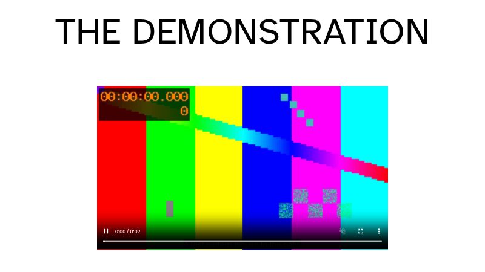

# The video element

The `video` element plays a WebM or an MP4 file in a slide. The document holds the file
one time, and the presenter plays it only in the present view.

```elixir
slide "demo" do
  video "demo/demo.webm" do
    title "The counter restarts"
    poster "demo/demo.png"
    width "60%"
  end
end
```

`Expresso.Builder` takes the same options, such as
`video("demo/demo.webm", title: "The counter restarts", poster: "demo/demo.png")`.

## The options

| Option | Value | Effect |
| --- | --- | --- |
| The first argument | The path of a `.webm` or a `.mp4` file, relative to [the root option](root-option.md) of the deck, or to the working directory of the command | The video. Required. |
| `title` | A string | The name of the video for a screen reader, and the text of the poster. Required. |
| `poster` | The path of an image | The image that shows on paper, in the handout view, in the speaker view, in the overview, in the menu and while the video loads. Required. |
| `captions` | The path of a `.vtt` file, relative to [the root option](root-option.md) of the deck | The captions of the video, in the WebVTT format. The browser shows them on the video. See "The captions". |
| `width` | A width, such as `900px` or `60%` | The largest width of the video. The default is `80%`. The video is narrower when the slide does not have the height for this width, as an embed is. |
| `aspect` | A ratio, such as `"4/3"` | The ratio of the width to the height. The default is `"16/9"`. |
| `loop` | `true` or `false` | Play the video again from the start at its end. The default is `true`. |
| `controls` | `true` or `false` | Show the controls of the browser, so the presenter can turn the sound on. The default is `false`. See "The controls in forced colors". |
| `external` | `true` or `false` | Keep the file next to the document, in place of a data URI in the document. The default is [the external option](external-option.md) of the deck, or `false`. See "A file next to the document". |
| `at`, `on`, `effect`, `speed`, `easing` | See [the overlay options](overlay-options.md) | The steps of the video, as for each other element. |
| `class` | CSS class names | See [the class option](class-option.md). |
| `morph` | A string | A key of the morph. See [the morph option](morph-option.md). |

The box of a video is the box of an embed. A deck can set `--embed-width` and
`--embed-aspect` in a rule of its CSS.

## When the video plays

| Place | Result |
| --- | --- |
| The present view, while the slide and the step of the video show | The video plays, with no sound. |
| A black screen, the menu or the overview | The video pauses, and it goes on from the same time after. |
| A move to another slide, and a move back | The video pauses, and it starts again from the start. |
| A later step on the same slide | A video that ended, or that the presenter paused with the controls, stays paused. |
| The speaker view, the handout view, the overview, the menu and paper | The poster shows. |

A browser starts a video with sound only after a click. Therefore the video has no sound,
and `controls true` lets the presenter turn the sound on.

## The controls in forced colors

Chromium does not show the controls of a video in forced colors, such as the high contrast
mode of Windows. It draws the controls on a white panel under the picture. With a dark color
scheme, the time and the track of the controls are white or cyan on that panel, so they do
not show. This is a defect of the browser, and not of Expresso. A page with no style sheet
gives the same panel, and the style sheet of the deck cannot change it.

A video without controls has no panel. For an audience that can use forced colors, do
these steps:

1. Remove `controls true` from the video, or give `controls false`. The default is `false`.
2. Play and pause the video with the keys of the deck.

These keys of the present view and of the speaker view control a video without controls:

| Key | Result |
| --- | --- |
| `j`, `→`, `↓`, `Page Down`, `Space` to the slide or to the step of the video | The video plays from the start. |
| `b` or `w` | The video pauses behind the black screen or the white screen. The next key or click shows the slide again, and the video goes on from the same time. |
| `o` or `m` | The video pauses behind the overview or the menu. When the overview or the menu closes with no move, the video goes on from the same time. |
| A key that goes to another slide | The video pauses. A move back starts it again from the start. |

A video without controls has no sound, because a browser starts a video with sound only
after a click. A click on the video goes to the next step. The captions show, and the
presenter cannot turn them off.

## The document

The renderer writes each file one time, as a data URI, into the element
`expresso-videos`. The element comes after the presenter script, so the deck answers a
key before the browser received the file. For a video with `external true`, it writes the address of a copy of
the file. Two video elements with the same file share it. Each copy of the slide
holds only a `video` element with `data-video`, the number of the file, and the poster
under it. The presenter gives the `video` element of the present view its source the first
time that it plays.

## A file next to the document

With `external true`, the document does not hold the video file. The render writes a
copy of the file into a directory next to the output file, and the element
`expresso-videos` holds the relative address of the copy:

| Output file | Directory of the copies | Address in the document |
| --- | --- | --- |
| `talk.html` | `talk_files/` | `talk_files/run-3f2a1c9e.webm` |
| `out/my talk.html` | `out/my talk_files/` | `my%20talk_files/run-3f2a1c9e.webm` |

These rules apply:

- The name of a copy holds the name of the file and eight digits of the SHA-256 of its
  content. A changed file gets a new name, so a web host can keep a copy in its cache for
  a long time.
- Two elements with the same file and `external true` share one copy.
- The browser asks for the file only when the video plays first, so the first slide does
  not wait for it. The browser can go to a time of the video before the whole file
  arrives.
- The poster and the captions stay in the document, as data URIs.
- The output must be a file. With `-`, the standard output, the document has no directory
  for the copy, and the renderer raises an `ArgumentError` that names the video and the
  option.
- Send the directory with the document. A document with no copy shows the poster.
- The render does not remove an old copy from the directory.

Each tool writes the copies next to its document:

| Tool | Where the copies go |
| --- | --- |
| `mix expresso talk.exs talk.html`, and the binary | `talk_files/`, next to `talk.html`. |
| `--watch` | The watch server sends them, and a video can go to a time. With an output file, they also go next to that file. With no output file, the address starts with the name of the input file, such as `talk_files/` for `talk.exs`. |
| `--check` | Next to the private document of a browser level, and next to the output file when the command has one. |
| `--pdf` and `--png` | Next to the private documents of the export, and next to the output file when the command has one. |

## The captions

The `captions` option gives a WebVTT file. The renderer writes it into the `video`
element as a `track` with `kind="captions"`, the label "Captions" and the attribute
`default`, so the browser shows the captions from the start. The track holds the file as a
data URI, because the document is one file. With `controls true`, the controls of the
browser can turn the captions off.

```text
WEBVTT

00:00:00.000 --> 00:00:01.000
A test pattern moves to the right.
```



## The errors

The compiler gives an error for:

- a first argument that is not the path of a `.webm` or a `.mp4` file,
- a video with no `title` or no `poster`,
- a `captions` option that is not the path of a `.vtt` file.

The renderer raises an `ArgumentError` for a captions file that it cannot read.

The renderer raises an `ArgumentError` for a video file or a poster that it cannot read.

The renderer raises an `ArgumentError` for a video with `external true` when the output is
the standard output:

```text
the video "demo/demo.webm" has external true, so the render must write a copy of the file
next to the document. This render has no output file, so it has no directory for the copy.
Give an output file, or remove the external option.
```

For the steps, see [Show a video](../how-to/show-a-video.md). For the settings of a web
host, see [Put a deck on a web host](../how-to/put-a-deck-on-a-web-host.md).
